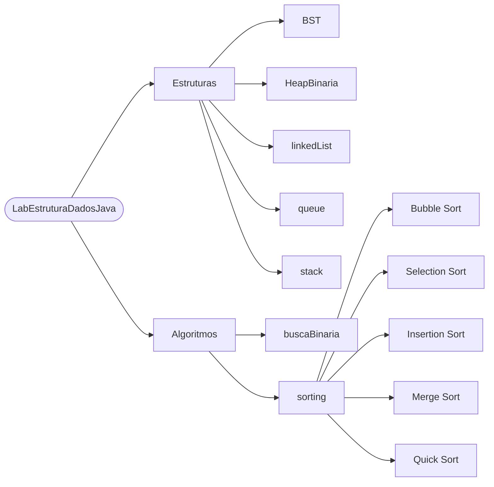
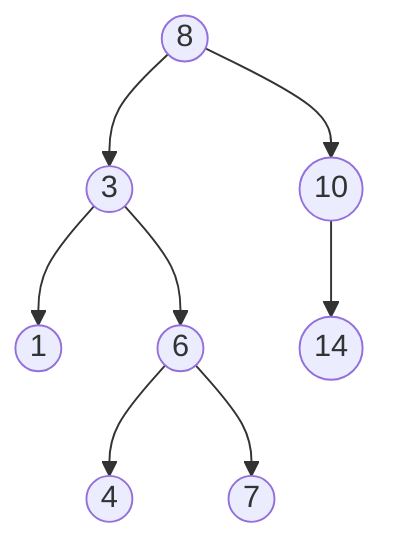
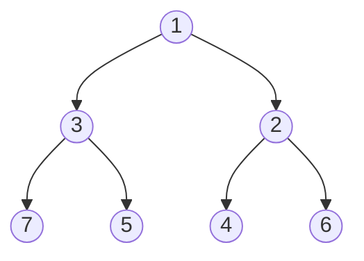
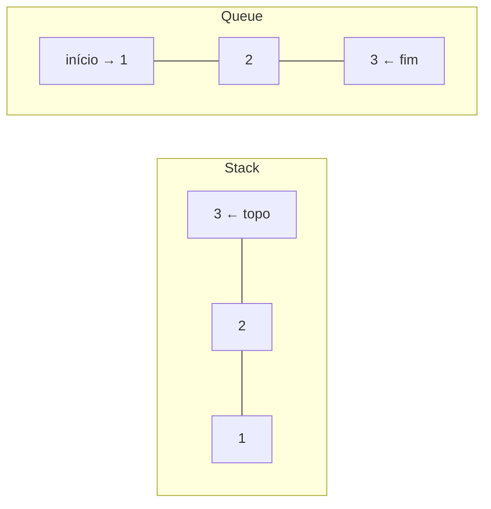
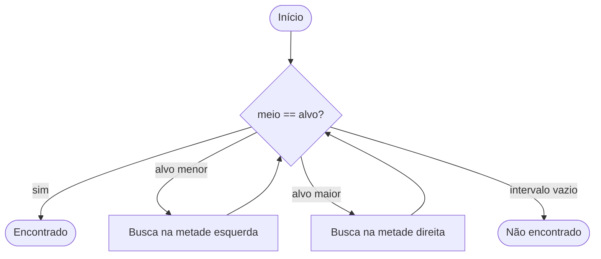
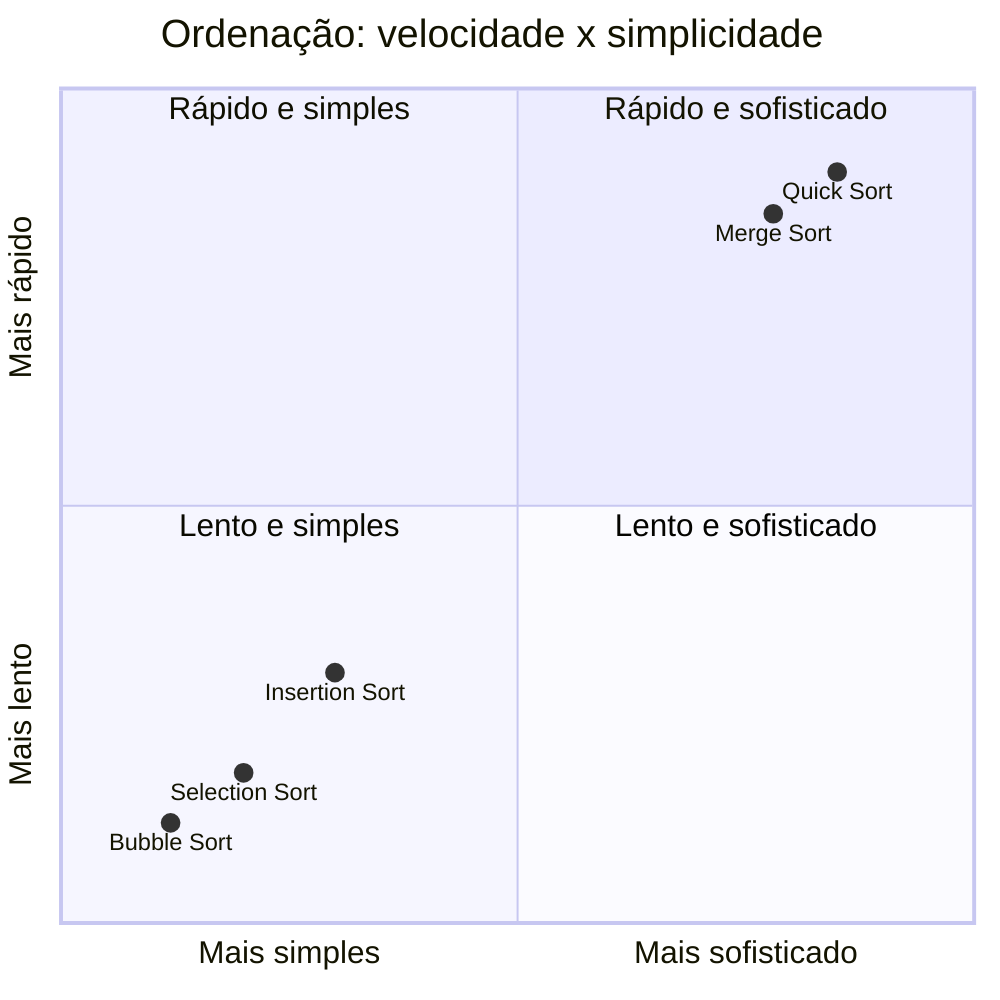

<div align="center">

# 🗂️ Estrutura de Dados em Java

Implementações próprias de estruturas de dados e algoritmos clássicos, desenvolvidas durante a graduação em Ciência da Computação na **UFCG**.


</div>

---

## 🧭 Mapa do repositório



---

## 🌳 Binary Search Tree

Cada nó guarda um valor; menores à esquerda, maiores à direita.



## ⛰️ Binary Heap (Min-Heap)

O menor elemento sempre fica na raiz.



## 🔗 Linked List

```mermaid
flowchart LR
    HEAD([head]) --> A[10 | •] --> B[20 | •] --> C[30 | •] --> NULL([null])
```

## 📚 Stack (LIFO) e 🚶 Queue (FIFO)



## 🔍 Busca Binária



---

## ⏱️ Complexidade

### Estruturas

| Estrutura | Inserção | Busca | Remoção |
|---|---|---|---|
| **BST** | O(log n) médio · O(n) pior | O(log n) médio · O(n) pior | O(log n) médio · O(n) pior |
| **Binary Heap** | O(log n) | O(n) | O(log n) |
| **Linked List** | O(1) no início | O(n) | O(n) |
| **Stack** | O(1) | O(n) | O(1) |
| **Queue** | O(1) | O(n) | O(1) |
| **Busca Binária** | — | O(log n) | — |

### Algoritmos de ordenação

| Algoritmo | Melhor caso | Médio | Pior caso | Estável |
|---|---|---|---|---|
| **Bubble Sort** | O(n) | O(n²) | O(n²) | ✅ |
| **Selection Sort** | O(n²) | O(n²) | O(n²) | ❌ |
| **Insertion Sort** | O(n) | O(n²) | O(n²) | ✅ |
| **Merge Sort** | O(n log n) | O(n log n) | O(n log n) | ✅ |
| **Quick Sort** | O(n log n) | O(n log n) | O(n²) | ❌ |



---

## 📁 Estrutura

```
LabEstruturaDadosJava
├── BST
├── HeapBinaria
├── buscaBinaria
├── linkedList
├── queue
├── sorting
└── stack
```

---

<div align="center">

**Guilherme Macario** · Ciência da Computação · UFCG · Campina Grande, PB

[](https://www.linkedin.com/in/guilherme-macario-900a7733b/)
[](https://github.com/usguilherme)

</div>